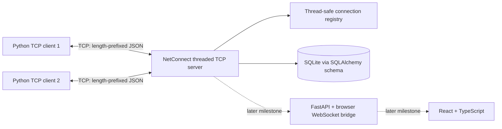
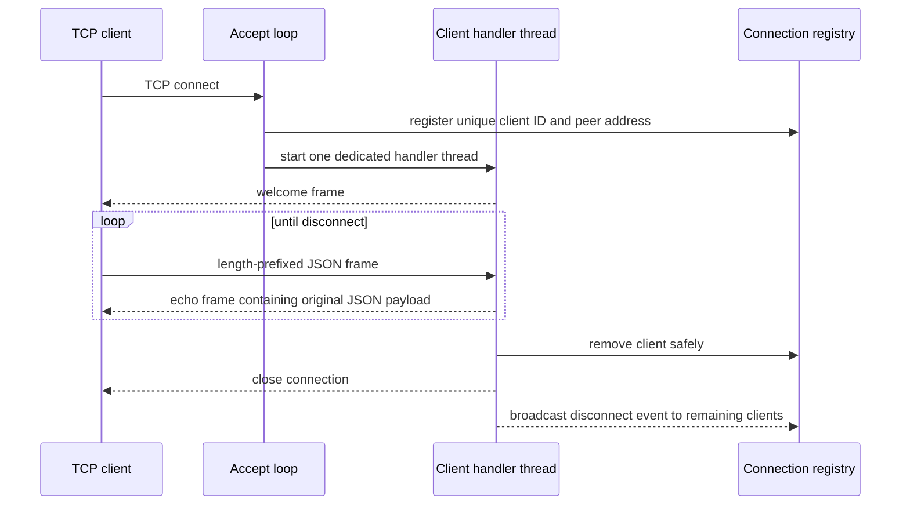

# Milestone 1 architecture

## Connection lifecycle

## Concurrency and framing

The listening socket accepts clients continuously. Each accepted socket is handled in its own daemon thread, so waiting for or losing one client does not stop acceptance or other client handlers. A lock protects the connection registry and counters. Each connection has an independent send lock because server-originated events and responses can be sent by different threads.

TCP is a byte stream, not a message protocol. A `recv()` may return a partial header, a partial body, or bytes spanning multiple application writes. NetConnect uses a four-byte network-byte-order length prefix and loops until the complete header/body is read. The decoder rejects zero-length and oversized frames and invalid JSON objects. Sending similarly loops until all bytes are written.

The standalone server currently echoes JSON payloads and broadcasts disconnect events. The database initializes a minimal normalized user/role foundation; account authentication and the full schema belong to later milestones.

## Security and deployment note

The server defaults to loopback only. Binding to `0.0.0.0` is intended only for a trusted lab LAN with appropriate firewall rules. This milestone does not claim TLS or user authentication; do not use it to carry sensitive data over untrusted networks.
